# Real-Time Telemetry Device with Cellular Connectivity

**Bachelor's Thesis · Industrial Electronics Engineering · University of Málaga (2024)**

Design, manufacturing and programming of a compact telemetry device for motorsport. It measures **position, speed and acceleration** in real time, shows them on a built-in display and is ready to send data to the cloud over **LTE Cat-M / NB-IoT**.

  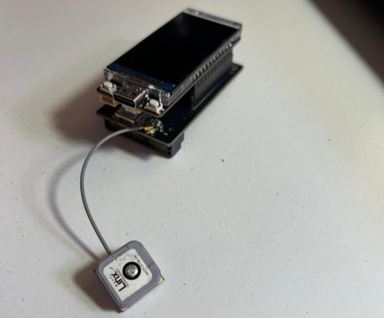
  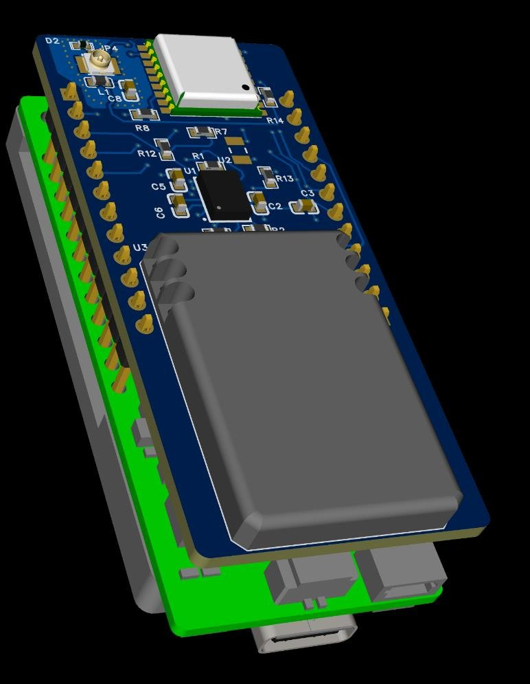
  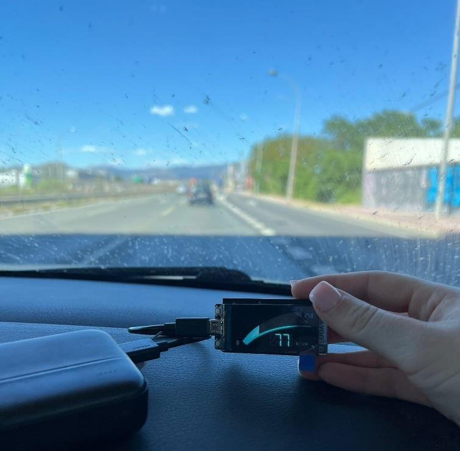

> 🇪🇸 **Resumen:** Trabajo Fin de Grado en Ingeniería Electrónica Industrial (UMA, 2024). Diseño y fabricación de un dispositivo de telemetría para motociclismo con GPS, IMU de 9 ejes y módulo SIM 4G. Incluye una PCB propia de 4 capas, interfaz gráfica en una pantalla ESP32-S3 y pruebas en carretera.

---

## 🎯 Context

This project was developed within **SynRide**, part of the University of Málaga's project maturation programme. The aim is to bring motorsport-grade data acquisition to amateur riders and small circuits (karting, riding schools), where professional systems are too expensive or closed.

**Goals:**

- 📍 **Location:** GNSS receiver with a sampling rate close to what is used in competition
- 🧭 **Acceleration, speed and lean angles:** 9-axis IMU
- 📡 **Data transmission:** cellular module (SIM) to upload data to the *SpeedSense* web platform

## 🔧 Hardware

| Module | Part | Interface | Why |
|---|---|---|---|
| MCU + display | LILYGO **T-Display-S3** (ESP32-S3, 1.9" 320×170 ST7789) | 8-bit i80 | Powerful dual core, integrated display, compact |
| GNSS | u-blox **MAX-M10S** | I2C | Up to 25 Hz navigation rate, low power |
| IMU | Bosch **BNO055** | I2C | 9-axis with on-chip sensor fusion |
| Cellular | **SIM7080G** (M5Stack STAMP Cat-M) | UART | Cat-M / NB-IoT, minimal footprint |

### Two prototype iterations

| | Prototype 1 | Prototype 2 (final) |
|---|---|---|
| Base board | T-SIM7080G-S3 | T-Display-S3 (stacked carrier PCB) |
| Positioning | MAX-M10S + DWM3000 (UWB, ~10 cm) | MAX-M10S |
| IMU | BNO055 + BMI323 | BNO055 |
| Display | — | ✅ |
| Result | Too dense to route, no display | Smaller, simpler, fully working |

  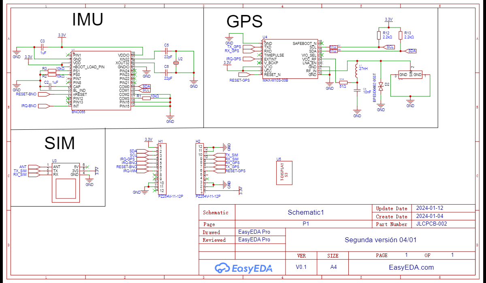
  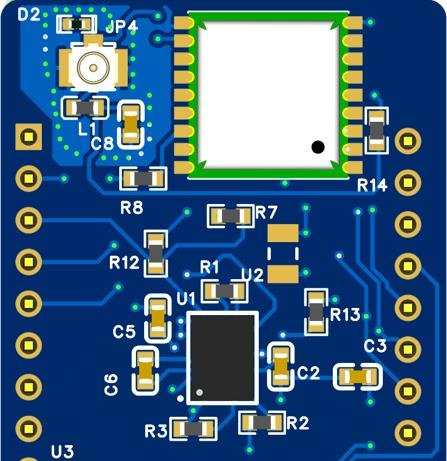

**PCB design (EasyEDA, 4 copper layers):**

- Dedicated **GND and VCC inner planes** for low-noise reference and power integrity
- **IMU placed at the board centre** for representative motion data
- **GNSS and antenna kept away** from the other parts, with a GND guard area around the RF passives
- No 90° traces; **DRC/ERC** checks; layout matched to the T-Display-S3 header so both boards stack

  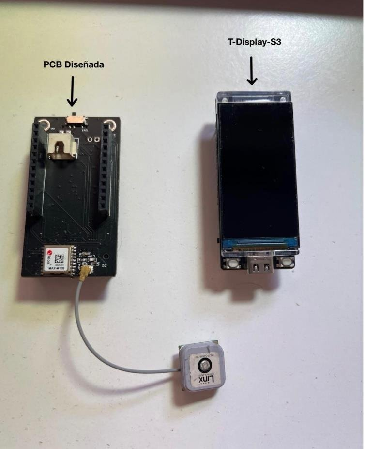
  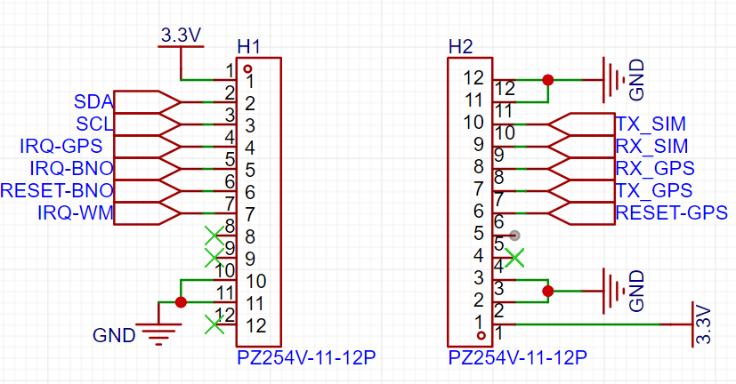

## 💻 Firmware

Written in **Arduino IDE (C++)** for the ESP32-S3. The UI was designed in **SquareLine Studio** and runs on **LVGL**.

- Custom **ST7789 driver over an 8-bit parallel bus** (ESP-IDF `esp_lcd`) with LVGL's flush callback
- **GNSS** in UBX binary mode (NMEA off) with auto-PVT. Speed comes from the NED velocity vector (mm/s → km/h)
- **IMU** events: Euler orientation, gyroscope, linear acceleration, magnetometer, gravity, plus calibration status
- **Two screens**, switched with the side button:
  - **Screen 1:** speed gauge
  - **Screen 2:** satellites, latitude/longitude, altitude, acceleration X/Y/Z

  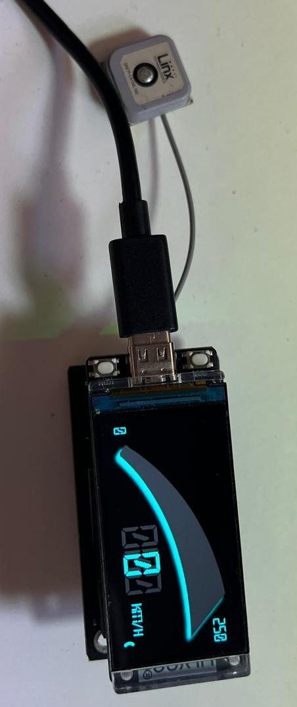
  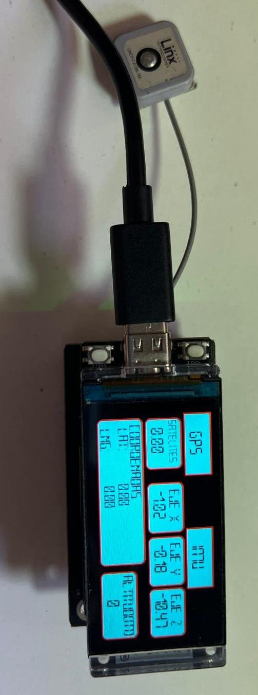
  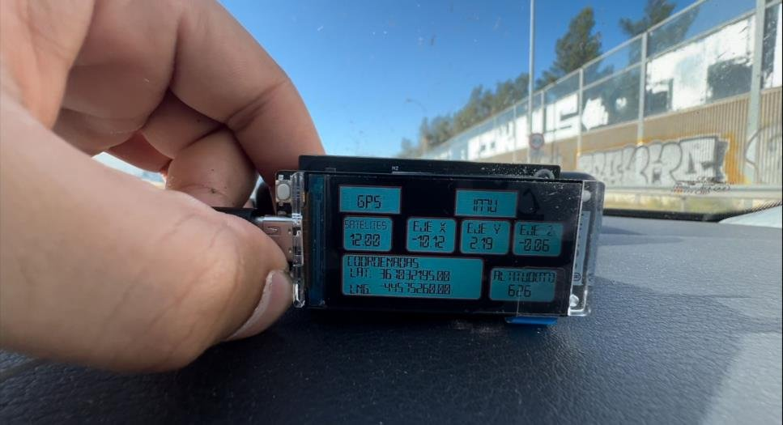

➡️ Code and build notes: [`firmware/`](firmware/)

## 🧪 Testing

1. **Static test (indoors):** checked the display, the UI and the sensor start-up
2. **Road test (in a car):** checked GNSS fix (10–11 satellites), the speed reading and the coordinates against a map
3. **Route reconstruction:** logged time, latitude, longitude and satellite count over the serial port for about 3 minutes, then plotted the route on OpenStreetMap with MATLAB ([`analysis/plot_route.m`](analysis/plot_route.m))

  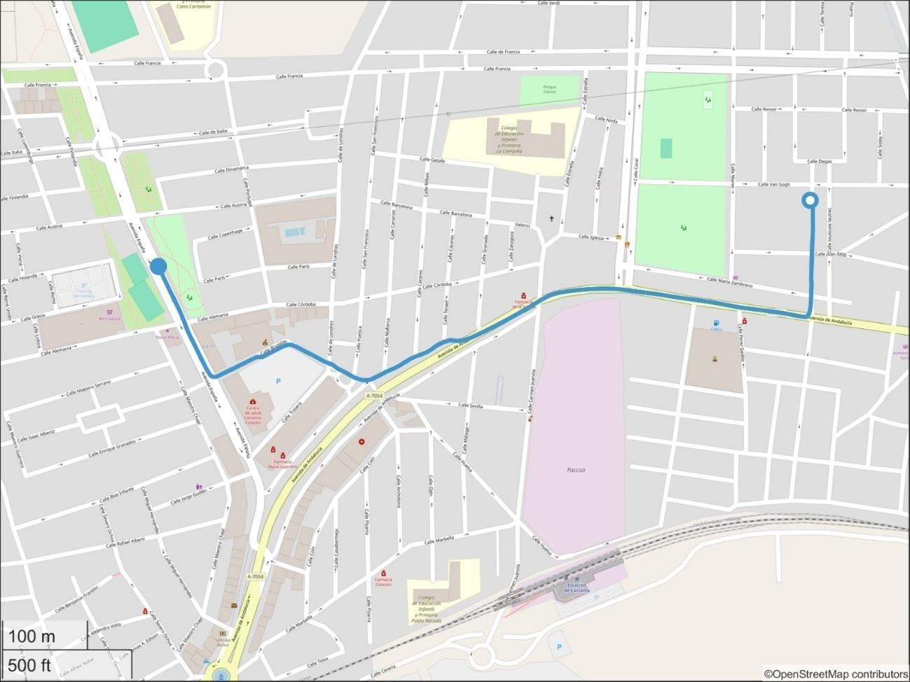

## 🔭 What I would improve today

Looking back at this project with more experience:

- **Thread safety:** the button interrupt calls LVGL directly. LVGL is not ISR-safe, so I'd set a flag in the ISR and switch screens in `loop()`, or use the `OneButton` objects that are already declared.
- **Use the GNSS rate:** the MAX-M10S supports up to 25 Hz, but the firmware runs it at 2 Hz and polls at 1 Hz. For lap timing I'd use 10–25 Hz with non-blocking reads.
- **Speed calculation:** use the receiver's ground speed (`gSpeed`) instead of the 3D NED magnitude, which also includes vertical velocity.
- **Acceleration values:** the on-screen values come from the raw accelerometer, which includes gravity, not from the linear-acceleration vector.
- **Robustness:** replace the blocking `while(1)` on sensor errors with retries and an error message on screen. Initialise I2C only once.
- **Data pipeline:** log to SD or flash in CSV, add timestamps from GNSS time, and finish the **Cat-M upload** to the cloud (MQTT/HTTP).

## 📄 Documentation

- 📘 [Full thesis report (Spanish, PDF)](docs/TFG_memoria_Julian_Samblas.pdf)
- 📊 [Defence presentation (Spanish, PDF)](docs/TFG_presentacion_Julian_Samblas.pdf)

## 🛠️ Tech stack

`ESP32-S3` `C/C++` `Arduino` `LVGL` `SquareLine Studio` `EasyEDA` `PCB design` `I2C` `UART` `GNSS / u-blox UBX` `IMU / BNO055` `LTE Cat-M / NB-IoT` `MATLAB`

---

**Author:** Julián Samblás Caballero · [LinkedIn](https://www.linkedin.com/in/julian-samblas-caballero-b3157a283/)
**Supervisors:** Javier Pérez Fernández, Francisco José Sánchez Pacheco · University of Málaga
