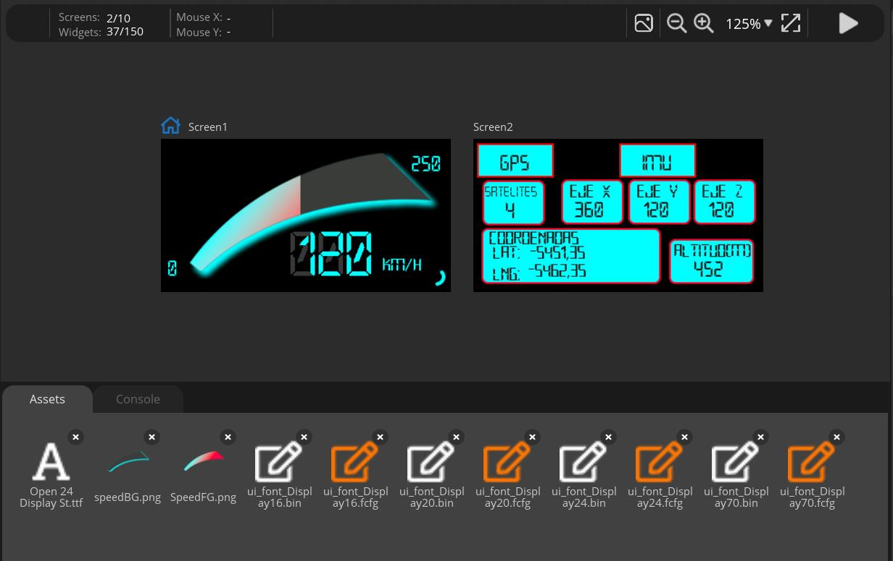

# Firmware

Arduino sketch for the LILYGO **T-Display-S3** (ESP32-S3) running the telemetry UI.

## Files

| File | Description |
|---|---|
| `telemetry_display/telemetry_display.ino` | Main program: ST7789 display driver + LVGL, GNSS and IMU acquisition, UI updates |
| `telemetry_display/pin_config.h` | T-Display-S3 pin map |

## Libraries (Arduino IDE)

- [LVGL](https://github.com/lvgl/lvgl) 8.3.x
- [TFT_eSPI](https://github.com/Bodmer/TFT_eSPI)
- [OneButton](https://github.com/mathertel/OneButton)
- [Adafruit BNO055](https://github.com/adafruit/Adafruit_BNO055) + Adafruit Unified Sensor
- [SparkFun u-blox GNSS Arduino Library](https://github.com/sparkfun/SparkFun_u-blox_GNSS_Arduino_Library)

Board: **ESP32S3 Dev Module** (ESP32 Arduino core 2.x), PSRAM enabled.

## UI files (SquareLine Studio)

The two screens were designed in **SquareLine Studio** and exported as LVGL C code
(`ui.c`, `ui.h`, `ui_Screen1.c`, `ui_Screen2.c`, `ui_helpers.*`, `ui_events.h`, plus the generated
images and fonts). These generated files go in the same folder as the `.ino`.
Their full listing is in Annex A of the [thesis report](../docs/TFG_memoria_Julian_Samblas.pdf).

<p align="center">
  
</p>

## Data flow

```
MAX-M10S (I2C, UBX/PVT) ──┐
                          ├──> ESP32-S3 ──> LVGL UI (speed, sats, lat/lon, altitude, accel XYZ)
BNO055   (I2C, 9-axis) ───┘          └────> Serial log (115200 baud) ──> MATLAB route plot
SIM7080G (UART, Cat-M/NB-IoT) ──> cloud upload (next project phase)
```
